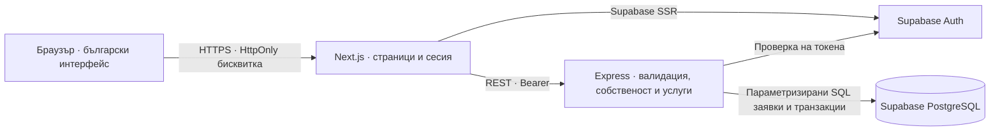

# Архитектура

Общият училищен каталог и личната банка използват отделни хранилища в частната схема. Express избира хранилище според параметрите за генериране и предава еднакъв формат на кандидатите към алгоритмите. След подбора копира само избраните въпроси. Филтрирането по клас, предмет и трудност се изпълнява преди подбор в същата транзакция.

Презентационният слой използва маршрути за вход, банка, конфигуриране, симулация, история и анализи. Next.js проверява защитените маршрути и обновява сесията чрез Supabase SSR. Отговорът се отбелязва веднага, а отделен индикатор показва потвърждението от Express. Фронтендът използва локално монотонно време и сървърния часовник за визуализация на оставащите секунди.

В бизнес слоя маршрутите валидират параметрите чрез Zod и подават проверения потребител към хранилищата и услугата за изпити. Банката изпълнява SQL операции чрез едно хранилище. Услугата за изпити координира алгоритмите, заключването, срока и оценяването. Общ middleware оформя структурирани грешки и записва метод, маршрут, статус и време.

Слоят за данни ползва пул от PostgreSQL връзки. Миграцията създава частна схема `examforge`. Критичните записи използват транзакции. При оценяване и запис на отговор редът на изпита се заключва преди проверката на срока. Изпитните въпроси се четат от съхраненото копие.

Идентичност и данни имат отделни интерфейси. Supabase Auth управлява регистрацията, потвърждението и токените. Express използва проверения UUID. Приложните таблици се достъпват през PostgreSQL, с параметри и явни проверки за собственост.
