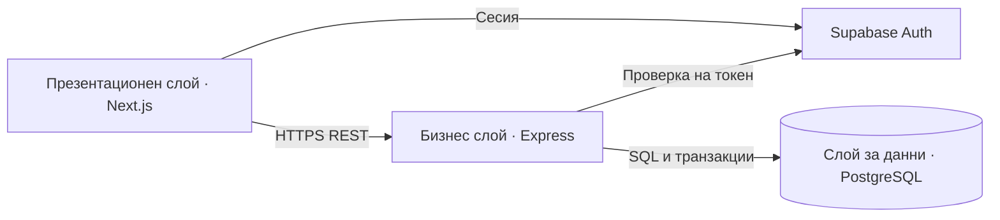
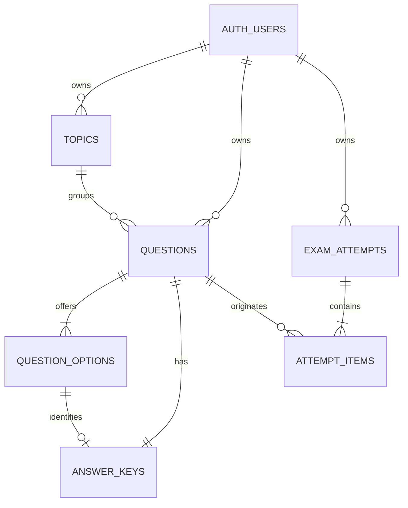
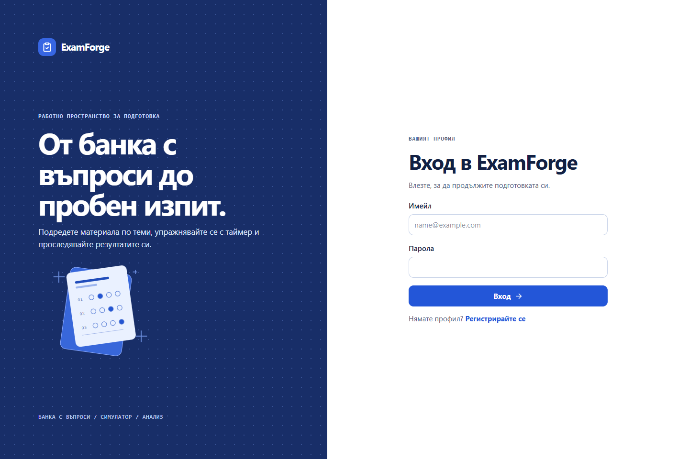
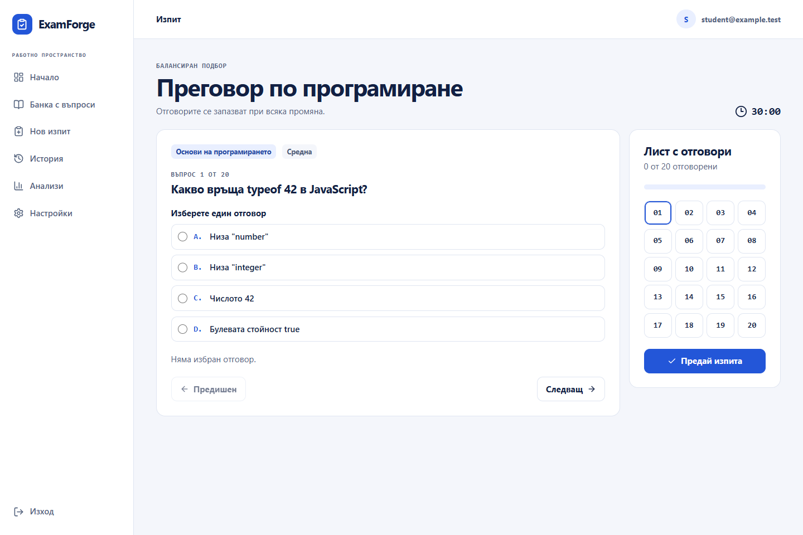
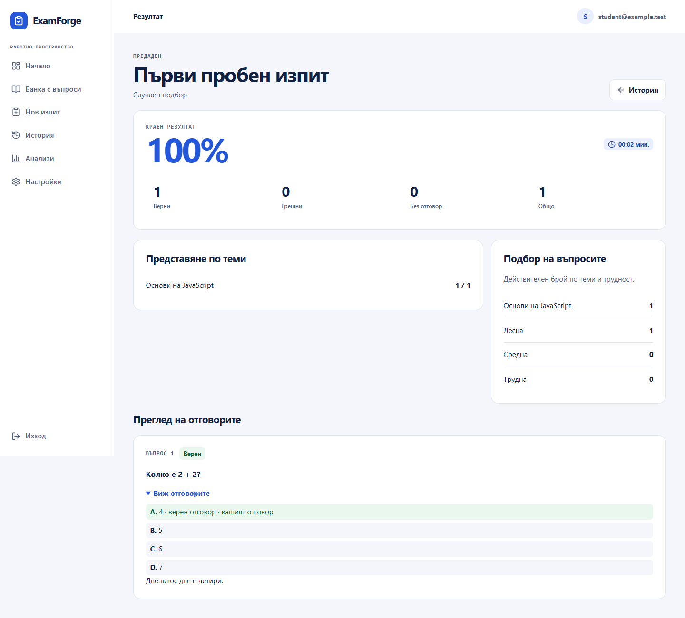
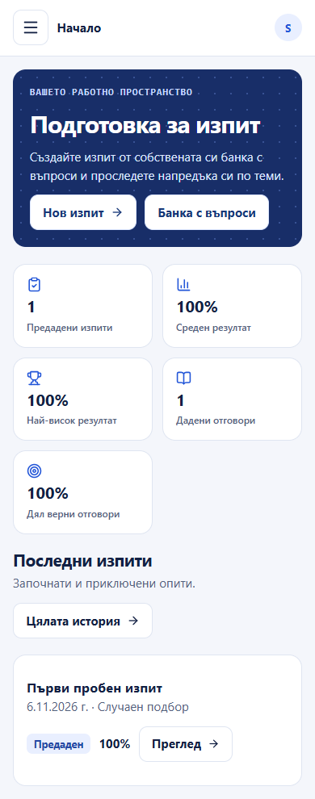
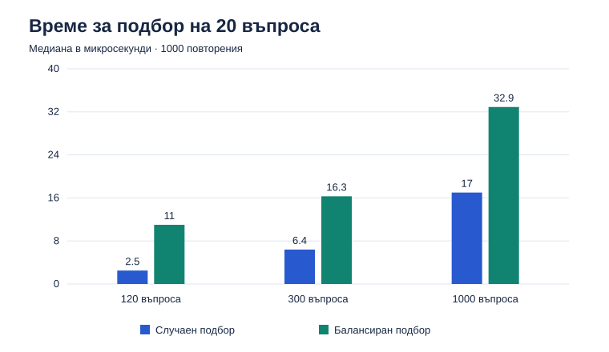
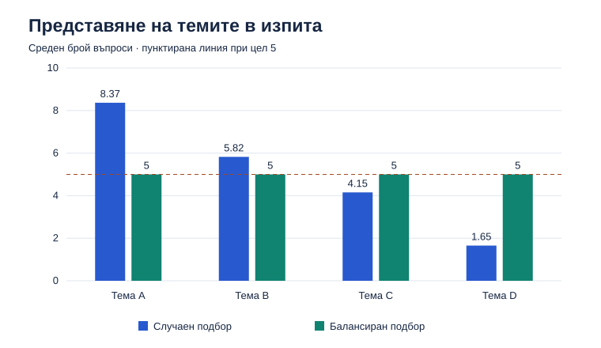

# КУРСОВА РАБОТА

**Обща тема:** „Разработване и изследване на програмни решения“

**Заглавие:** „Разработване и изследване на уеббазирана система за автоматично генериране и оценяване на тестове чрез алгоритми за подбор на въпроси“

| | |
|---|---|
| Студент | [Име и фамилия] |
| Факултетен номер | [Факултетен номер] |
| Университет и факултет | [Университет и факултет] |
| Дисциплина | [Дисциплина] |
| Преподавател | [Име на преподавателя] |

## 1. Увод

При самостоятелна подготовка студентът трябва едновременно да организира учебния материал, да избере представителен набор от задачи и да оцени собствените си отговори. Ръчното съставяне на тестове изисква време и може да доведе до прекомерно представяне на темите с най-много налични въпроси. Съхраняването на резултатите в обща система позволява да се наблюдава промяната в представянето и да се открият теми с повече грешки.

Целта на разработката е да се реализира ExamForge, уеб система с лична банка и общ учебен каталог за автоматично съставяне и оценяване на пробни изпити. Задачите включват проектиране на релационна схема, реализиране на удостоверяване и изолация на данните, разработване на два метода за подбор, управление на времето, автоматично оценяване и експериментално сравнение. Приложението служи за индивидуална подготовка. Банките съдържат въпроси с четири възможности и един верен отговор.

## 2. Анализ на проблема

Потребителят трябва да може да се регистрира, да създава теми, да управлява въпросите, да избира параметри за изпит, да записва отговори и да разглежда история и показатели. Необходимо е интерфейсът да работи на мобилен и настолен екран. Правилният отговор и обяснението принадлежат към данните за оценяване. Активният изпит използва отделна проекция на данните.

Случайният подбор осигурява равна вероятност за всеки допустим въпрос. В банка с неравни теми това дава по-висок очакван брой въпроси от по-големите теми. Разпределението по квоти решава различна задача, при която изпитът трябва да покрие избраните области с предвидима пропорция. Квотите по тема и трудност могат да си противоречат при ограничен капацитет. Затова се задава измерим критерий за отклонение и ясен приоритет между целите.

Нефункционалните изисквания включват предвидимо поведение при повторни заявки, защита на личните записи, валидиране на входа, възпроизводими измервания и възможност за стартиране на frontend и backend като отделни процеси. Изборът на REST API и PostgreSQL позволява ясна граница между интерфейса, бизнес логиката и трайното състояние.

## 3. Проектиране на системата



*Фигура 1. Комуникация между трите слоя и услугата за идентичност.*

Презентационният слой показва състояния за зареждане и грешки и предава действията на потребителя. Бизнес слоят приема HTTP заявки и проверява данните чрез Zod. Идентификаторът на потребителя се извлича от проверен Supabase токен. Извличането на конкретен запис комбинира ключа на записа и този идентификатор. Използва се еднакъв отговор при липсващ и чужд запис. Само Express използва SQL връзка към базата.

Създаването на опит, записът на отговор и оценяването имат отделни API операции. Записът на отговор и предаването заключват реда на изпита. След заключване се сравнява текущото PostgreSQL време с крайния срок. При изтекъл опит се оценяват вече съхранените отговори, а късен запис се отхвърля. Изтичането се обработва при достъп до опита, историята или анализите. Повторното предаване връща записания резултат.

## 4. Проектиране на базата данни



*Фигура 2. Връзки между основните обекти в базата.*

`topics` и `questions` имат UUID, идентификатор на собственик, атрибути на съдържанието и времеви полета. Трудността е число между 1 и 3. Съставният външен ключ гарантира, че въпросът е в тема на същия собственик. `question_options` пази опциите A–D, а `answer_keys` пази една опция за въпрос. Съставният ключ гарантира, че верният отговор е опция на съответния въпрос. Отложените проверки се изпълняват в края на транзакцията.

`exam_attempts` пази метода, статуса, датите и броя верни отговори. `attempt_items` пази позиция и копие на въпроса, темата и опциите. Историята остава стабилна след редакция на банката. Идентификаторите на изпитните опции са уникални за копието. Уникалните ограничения за изпит и въпрос, както и за изпит и позиция, предотвратяват дублиране. Записът в `attempt_items` пази избраната опция и резултата от сравнението.

Индексите по собственик и тема подпомагат филтрирането на банката. Хронологичният индекс обслужва историята, а частичният индекс за активни опити подпомага търсенето на изтекли срокове. Въпросите се архивират, за да се запазят връзките с историята. Таблиците са в частна схема с включена RLS и отнети права за клиентските роли.

## 5. Използвани алгоритми

### 5.1. Случаен подбор

При частичния Fisher–Yates за всяка от първите k позиции се избира равномерно индекс от текущата позиция до края. Двата елемента се разменят и вече фиксираната позиция се изключва от следващите избори. Така изборът е без връщане и всяка наредена k-извадка има равна вероятност при равномерен източник. Методът проверява броя кандидати и уникалността на идентификаторите. Допълнителната памет е O(n), а проверката, копирането и размените изискват O(n + k) време.

```text
копирай n въпроса
за i = 0, …, k − 1
    j ← случаен цял индекс в [i, n − 1]
    размени A[i] и A[j]
върни A[0 … k − 1]
```

### 5.2. Балансиран подбор

Целевият брой по тема е k, разделено на броя теми. По трудност целта е 30% лесни, 50% средни и 20% трудни. Методът на най-големия остатък взема целите части, след което раздава неизползваните места по намаляващ дробен остатък. При равенство се използва стабилен ред. За 20 въпроса и четири теми това дава 5 въпроса от тема и обща разбивка 6, 10, 4 по трудност.

Кандидатите се групират по тема и трудност. Между съответните върхове се добавя ребро с капацитет, равен на броя въпроси в групата. Първите места до квотата имат нулева цена. Над квотата се начисляват k + 1 за тема и 1 за трудност. При фиксиран размер броят допълнителни места е половината от сумата на абсолютните отклонения. Избраните цени гарантират приоритет на тематичното отклонение, тъй като разликата в цената по трудност е най-много k. Последователни най-евтини пътища разпределят потока, а обратните ребра допускат преразпределение. След това въпросите се избират случайно във всяка използвана група.

При t теми и три фиксирани трудности графът има O(t) върха и ребра. Обработка с Bellman–Ford и до k увеличавания дава горна граница O(n + t log t + kt²), а допълнителната памет е O(n + t). При недостиг в отделни клетки се допуска отклонение и то се вижда в резултата. Ако общият капацитет е по-малък от k, системата връща грешка.

### 5.3. Автоматично оценяване

Всеки избран идентификатор се сравнява с верния отговор от изпитното копие. Празният отговор носи нула точки и се отчита отделно. Процентът е броят верни, разделен на общия брой и умножен по 100. Сравненията са линейни по броя въпроси. Следният откъс е от модула за оценяване.

```ts
const verdicts = items.map(item => item.selected_option_id === item.correct_option_id);
const correct = verdicts.filter(Boolean).length;
const unanswered = items.filter(item => item.selected_option_id === null).length;
```

Услугата записва правилността и оценката атомарно, след което предоставя общ резултат, време, разбивка по теми и обратна връзка.

## 6. Програмна реализация

Проектът е npm monorepo с отделни пакети за Next.js и Express. Модулите за подбор и оценяване са отделени от SQL и HTTP. Браузърът използва Supabase JS за сесията и изпраща access token към API. Пакетът на Express използва Zod за заявки и `pg` за параметризирани SQL операции. Миграцията и учебната банка се доставят отделно. Seed скриптът зарежда по 30 въпроса в четири теми и може да се изпълни отново за същия профил.

Българският интерфейс включва банка с филтри, форма за изпит, симулатор с таймер и навигация по въпроси, резултат и история. Системата показва отговора като запазен след потвърждение от API. Графиките в анализите използват Recharts и се придружават от текстови стойности или табличен преглед.

Екранните снимки са заснети от приложението по време на автоматизиран тест в Edge. Данните са записани през Express в тестова PostgreSQL база. Използван е локален заместител на Auth услугата. Реалната доставка на писма, подписването на токени и връзката през Supabase pooler изискват проверка в целевия Supabase проект.



*Фигура 3. Вход в приложението.*



*Фигура 4. Симулатор с таймер и навигация по 20 въпроса.*



*Фигура 5. Резултат от тестов опит и обратна връзка.*



*Фигура 6. Мобилно табло с резултат, записан в тестовата база.*

### 6.1. Разширяване на учебния каталог

В общата банка класът и предметът образуват отделна релационна връзка, към която принадлежат темите. При създаване на изпит сървърът първо ограничава кандидатите до избраната комбинация. След това прилага филтрите за активност, тема и трудност и сравнява наличния брой със заявения. Едва тогава извиква съответния алгоритъм. При ограничение до една трудност квотата по трудност се насочва към това ниво. Теми без допустими въпроси не участват в разпределението на каталожните квоти. Подборът от лични теми остава достъпен чрез отделен режим.

При генериране се записва копие на класа, предмета и учебното съдържание. Ключът се използва на сървъра и се връща на собственика при преглед на приключилия опит. Аналитичните филтри обхващат клас, предмет и период и се прилагат върху опитите на текущия потребител. Интерфейсът поддържа тъмен, светъл и системен режим с локално запазване на предпочитанието.

Каталогът съдържа 3 600 активни въпроса в 36 банки с по 100 въпроса на комбинация предмет–клас. Всеки комплект включва 50 първоначални и 50 добавени въпроса. Общата банка има отделни 250 записа. Пълното съответствие с учебните програми изисква предметен преглед. Филтрите определят множеството кандидати преди подбора. Експериментите по-долу използват контролирани набори и измерват самия подбор. [Обхват и източници на каталога](catalogue-bg.md) · [Одит на реалната база](audit/EXAMFORGE_FINAL_AUDIT.md)

Сървърният вход управлява сесията чрез Supabase SSR. Защитените страници проверяват сесията при заявка. Next.js изпраща Bearer токена към отделния Express слой, който валидира токена и прилага проверките за собственост. Бисквитките имат HttpOnly, SameSite и политика за срок според избора „Запомни ме“. Сървърният подход премества Supabase клиента за вход извън началния JavaScript на браузъра.

## 7. Експериментални резултати

Изследователският въпрос е как случайният и балансираният подбор влияят на тематичното покритие и времето за генериране. Хипотезата е, че балансираният метод дава по-предсказуемо покритие с допълнителна изчислителна работа.

Измерването е извършено с Node.js v24.21.0, Windows x64 10.0.26300 и Intel Core Ultra 9 386H. За банките от 120, 300 и 1000 кандидата са изпълнени 200 подгряващи и 1000 отчетени повторения на метод. Всеки изпит има 20 въпроса. Алгоритмите се редуват в различен ред на всяка итерация. Времето обхваща само подбора. Суровите измервания са в [performance.csv](../research/results/performance.csv), а пълното обобщение е в [summary.md](../research/results/summary.md).

*Таблица 1. Медиана и 95-и персентил на времето за генериране в микросекунди.*

| Размер на банката | Случаен, медиана | Случаен, P95 | Балансиран, медиана | Балансиран, P95 |
|---:|---:|---:|---:|---:|
| 120 | 2,5 | 3,6 | 11,0 | 35,5 |
| 300 | 6,4 | 8,7 | 16,3 | 29,0 |
| 1000 | 17,0 | 30,4 | 32,9 | 87,9 |



*Фигура 7. Медианно време за генериране на изпит от 20 въпроса.*

Експериментът за разпределение използва четири теми с 50, 35, 25 и 10 кандидата. Метриката е D = Σ|nᵢ − 5|, където nᵢ е броят избрани от тема i. За всеки метод са изпълнени 1000 повторения. При случаен подбор очакваните стойности от състава на банката са приблизително 8,33, 5,83, 4,17 и 1,67. Измерените средни стойности следват този модел.

*Таблица 2. Отклонение и среден брой въпроси по теми.*

| Подбор | Средно D | Медиана D | Макс. D | Тема A | Тема B | Тема C | Тема D |
|---|---:|---:|---:|---:|---:|---:|---:|
| Случаен | 9,804 | 10 | 20 | 8,368 | 5,824 | 4,154 | 1,654 |
| Балансиран | 0 | 0 | 0 | 5 | 5 | 5 | 5 |



*Фигура 8. Сравнение на представянето на четирите теми. Пунктираната линия означава цел от пет въпроса.*

Балансираният метод постига точната тематична цел при всеки опит от тази банка. Той има по-висока медиана за време при всички изследвани размери. Двата резултата подкрепят хипотезата при конкретните условия. Изследваните времена се отнасят до алгоритъма и могат да се влияят от JIT компилация, събиране на неизползвана памет и натоварването на машината. Само четири теми, един модел за трудности и една машина участват в измерването. При недостигащи клетки разпределението може да се отклони от целта. Експериментът не оценява педагогическата еквивалентност на въпросите.

Проверката за коректност включва тестове за точен размер, липса на повторения, недостиг, смесени отговори, недостъпни чужди записи, едновременни предавания и изтичане на срока. Всички 16 теста на backend преминаха. Измервателният скрипт провери уникалността и размера на всички 8000 отчетени извадки.

## 8. Заключение

ExamForge реализира създаване и управление на лична банка, генериране, провеждане и оценяване на изпити, както и преглед на историята и представянето. Изследването показва, че различните цели водят до различен подход. Случайният подбор запазва равната вероятност за включване на отделния въпрос и има по-ниска измерена медиана. Балансираният метод е подходящ, когато изпитът трябва да осигури контролирано тематично покритие. Изпитните копия и транзакционното заключване решават риска от промяна на условията и повторно оценяване.

Бъдещо изследване може да включи реални банки с различна плътност на клетките и по-голям брой теми, както и измерване на крайното време на заявката. Резултатите от съществуващия експеримент могат да се възпроизведат чрез скрипта и документираната методика.

## 9. Използвани източници

1. Next.js. [App Router Installation](https://nextjs.org/docs/app/getting-started/installation).
2. Express. [Error Handling](https://expressjs.com/en/5x/guide/error-handling/).
3. Supabase. [JavaScript getUser](https://supabase.com/docs/reference/javascript/auth-getuser).
4. Supabase. [Connect to your database](https://supabase.com/docs/guides/database/connecting-to-postgres).
5. PostgreSQL. [Row Security Policies](https://www.postgresql.org/docs/current/ddl-rowsecurity.html).
6. NIST Dictionary of Algorithms and Data Structures. [Fisher–Yates shuffle](https://www.nist.gov/dads/HTML/fisherYatesShuffle.html).
