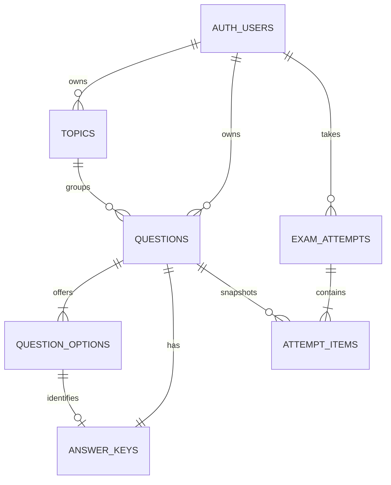

# База данни

| Таблица | Предназначение и ограничения |
|---|---|
| `topics` | UUID, собственик, име, описание и дати. Името е уникално без разлика между главни и малки букви при един собственик. |
| `questions` | Текст, обяснение, трудност 1–3, активност и дати. Съставният външен ключ гарантира общ собственик с темата. |
| `question_options` | Четири означения A–D за активен въпрос. Уникалността на двойката въпрос–буква предотвратява повторения. |
| `answer_keys` | Един верен отговор за въпрос. Съставният външен ключ доказва принадлежност на опцията. |
| `exam_attempts` | Собственик, метод, статус, срок, оценка и разпределение. Ограниченията свързват статуса с резултата и датите. |
| `attempt_items` | Позиция, източник, копия на тема, текст, трудност, опции, обяснение и ключ, плюс избран отговор и оценка. Уникални двойки по изпит и позиция, както и по изпит и въпрос. |

Отложените constraint triggers проверяват, че всеки активен въпрос има четири опции и ключ при commit. Това позволява създаването на свързаните редове в една транзакция. В историята опциите имат отделни UUID. Избраната и вярната опция трябва да присъстват в съхранения JSON масив. Тригерът за промяна на изпитен елемент допуска само запис на избор и оценка, докато опитът е активен.

Съставните индекси обслужват собственик, филтри и хронологични списъци. Частичният индекс за активни опити обслужва заявката за изтекли срокове. Поднизовото търсене е подходящо за индивидуални учебни банки и може да се преоцени при по-голям мащаб.

Изтриването на въпрос през API архивира. Теми със свързани въпроси остават защитени от FK, включително когато всички въпроси в темата са архивирани. При административно изтриване на профил каскадите премахват притежаваните данни. При внедряване изпълнете началната миграция веднъж. Следващи промени добавят нови номерирани SQL файлове.

Схемата е частна. Достъпът на `PUBLIC`, `anon` и `authenticated` е отнет и RLS е включена без клиентски политики. Сървърната PostgreSQL роля, която изпълнява заявките, трябва да е собственик на мигрираната схема и таблици или да има еквивалентните необходими права. Авторизацията в приложението остава задължителна, тъй като собственикът по подразбиране заобикаля RLS.

## Общ каталог и исторически опити

`grades` използва номера на класа като ключ. `subjects` използва устойчивия slug като ключ. `subject_grades` свързва двата каталога и записва учебния обхват. `catalogue_topics` принадлежи към точно една връзка, а `catalogue_questions` наследява предмета и класа от темата. Структурата на опциите, диапазонът на верния индекс и уникалността на източника се проверяват в базата. Частичен индекс обслужва активните въпроси по тема и трудност.

Личната тема може да има класификация `subject_grade_id`. При липса на класификация интерфейсът я отбелязва за преглед. `exam_attempts` записва връзката и копие на класа и името на предмета за каталожен изпит. `attempt_items` сочи точно един въпрос от личната или общата банка и пази копие на учебното съдържание към момента на генериране.

[Миграция 002](../database/migrations/002_catalogue.sql) е добавъчна и може да се изпълнява повторно. [Обратната миграция](../database/rollback/002_catalogue.sql) премахва общия каталог само ако няма опити или лични класификации, които го използват. При наличие на свързани записи запазете схемата и върнете версията на приложението при нужда.

[Миграция 003](../database/migrations/003_grade_12.sql) добавя XII клас и връзки към активните предмети. Може да се изпълнява повторно. Добавените въпроси преминават през същия валидатор и импорт като X и XI клас. Съществуващата лична банка за XII клас остава отделна от общата.

[Миграция 004](../database/migrations/004_review_cards.sql) добавя частната таблица `review_cards`. Тя записва състоянието на FSRS, следващия срок и версията на оценката за копието на въпроса в приключения опит. Наличните опити се четат при отваряне на преговора. За всеки въпрос последният оценен опит определя дали той влиза в опашката, а нова грешка създава нова карта от последното копие. Версията предотвратява двойно записване при повторена заявка.

[Миграция 005](../database/migrations/005_similar_questions.sql) използва наличното `pg_trgm` или го активира в схемата `extensions`. Точното съвпадение има предимство в търсенето. Сходство по думи се проверява от четири знака, а проверката за дубликат сравнява целия текст само с личната банка на профила.

Анализът на въпросите използва единствено приключените опити на текущия профил и групира копията с еднакъв текст, опции и верен отговор. За последно решаваната версия се изчислява корелация между верния отговор и дела верни отговори по останалите задачи. Нужни са поне 10 опита с повече от една задача и с вариация и в двата показателя.
