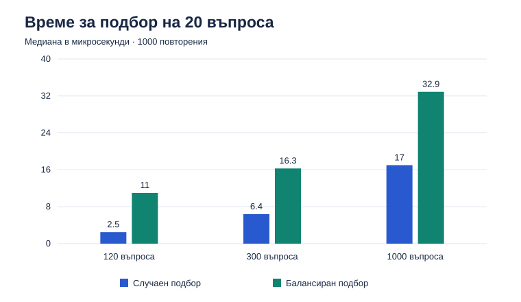
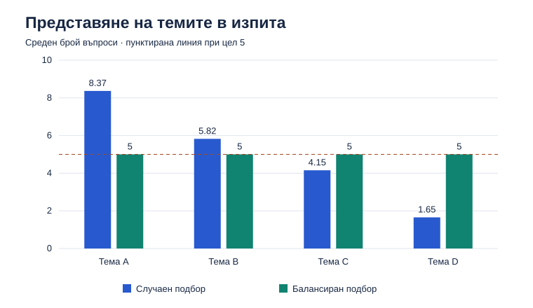

# Експериментално сравнение

Въпросът е как подборът променя тематичното разпределение и времето за генериране. Хипотезата е, че балансираният метод постига по-предсказуеми квоти с допълнителна обработка.

```sh
npm run benchmark
```

Скриптът `benchmarks/run.mjs` извиква алгоритмите от Express пакета. `datasets.mjs` създава записи със синтетични идентификатори, тема и трудност. За производителност банките са от 120, 300 и 1000 кандидата с по четири еднакво големи теми и циклични трудности. За всеки размер и алгоритъм се изпълняват 200 подгряващи и 1000 отчетени повторения. Редът на алгоритмите се сменя при всяка итерация. Времето се измерва чрез `performance.now()` само около извикването, без създаване на банката, генератора или проверката на резултата.

При разпределението банката е 50, 35, 25 и 10 въпроса. Всеки от 1000 опита за метод избира 20. Измерва се `D = Σ|брой по тема − 5|`. В двете серии началните състояния са възпроизводими. Числовите номера на повторенията се хешират до 32-битово състояние, за да не дават близки първи стойности при последователни номера.

Всяка извадка се проверява за точен размер и уникалност. Суровите времена са в `results/performance.csv`, а тематичните разпределения в `results/distribution.csv`. [Таблиците](results/summary.md) съдържат средно, медиана, P95 по най-близък ранг и стандартно отклонение за наблюдаваната серия. За разпределението са дадени средно, медиана, максимум и средни стойности по теми.





Медианата намалява влиянието на единични паузи от JIT, GC и операционната система. Синтетичните банки имат еднакъв модел на трудност. Отделният експеримент не измерва крайна латентност през мрежа или PostgreSQL. При липсващи категории отклонението на балансирания подбор може да е ненулево. За цел, при която всеки въпрос трябва да има равна вероятност за включване, случайният подбор е естественият избор.
